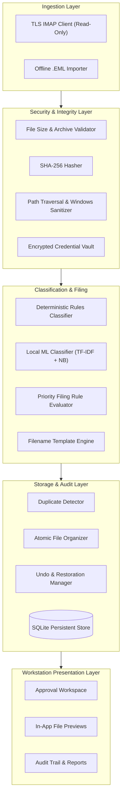

# ATTACHORA — System Architecture & Component Design

## 1. Architectural Overview

ATTACHORA is organized into a modular layered architecture separating ingestion, security, classification, rule evaluation, physical storage, and presentation.

## 2. Core Modules

| Module Path | Primary Responsibility |
|---|---|
| `src/config.py` | Central configuration, theme tokens, directory paths, and security limits |
| `src/database/schema.py` | Relational tables (`emails`, `attachments`, `filing_rules`, `operations`, etc.) |
| `src/database/db_manager.py` | Connection pooling, thread-safe transactions, and CRUD helpers |
| `src/security/sanitizer.py` | Windows filename sanitization and strict path traversal defense |
| `src/security/validator.py` | MIME guessing, max file size enforcement, and ZIP bomb protection |
| `src/security/hasher.py` | Cryptographic SHA-256 calculation for streams and disk files |
| `src/security/credential_vault.py` | Machine-derived encrypted tokens and masked credentials |
| `src/classifier/rules_classifier.py` | Explainable, deterministic pattern matching for 12 categories |
| `src/classifier/ml_classifier.py` | Retrainable TF-IDF Naive Bayes model for subtle text tokens |
| `src/classifier/engine.py` | Unified classification orchestrator |
| `src/rules_engine/rule_evaluator.py` | Priority-based evaluation of AND/OR condition groups |
| `src/rules_engine/template_engine.py` | Dynamic filename template substitution and collision numbering |
| `src/storage_manager/duplicate_detector.py` | SHA-256 deduplication and collision classification |
| `src/storage_manager/organizer.py` | Atomic copying, folder creation, and status logging |
| `src/storage_manager/undo_manager.py` | Safe rollback of organized files back to staging |
| `src/analytics/reporter.py` | Database-backed KPI aggregation and CSV generation |
